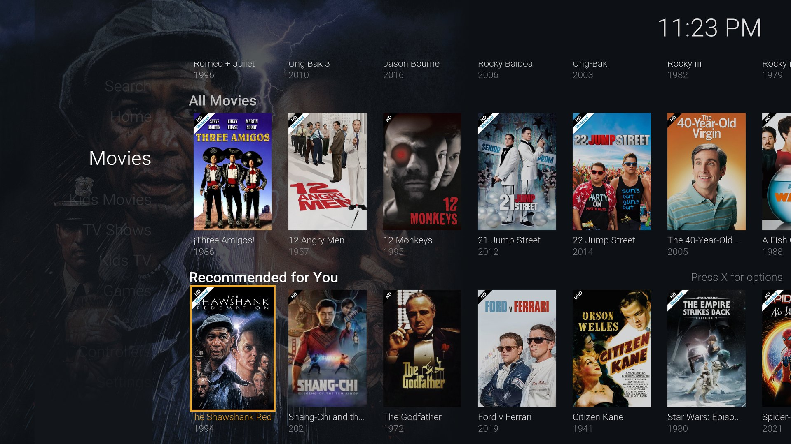
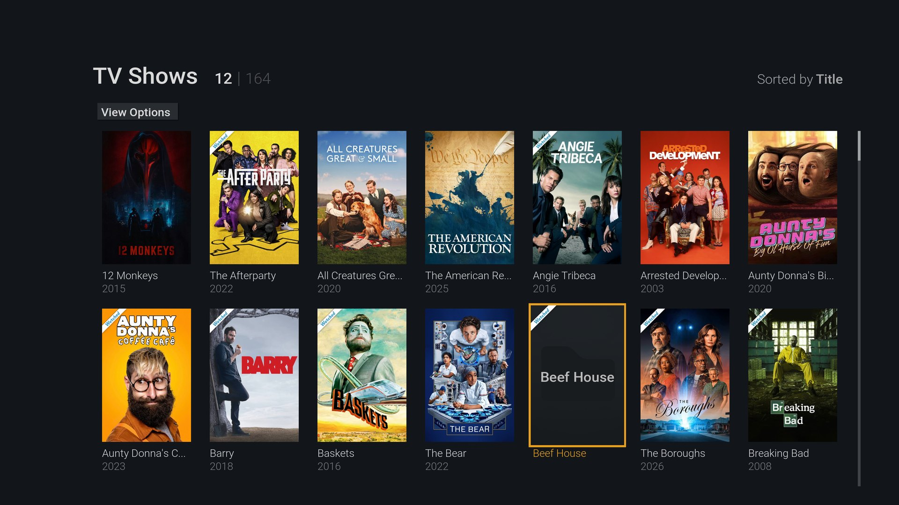
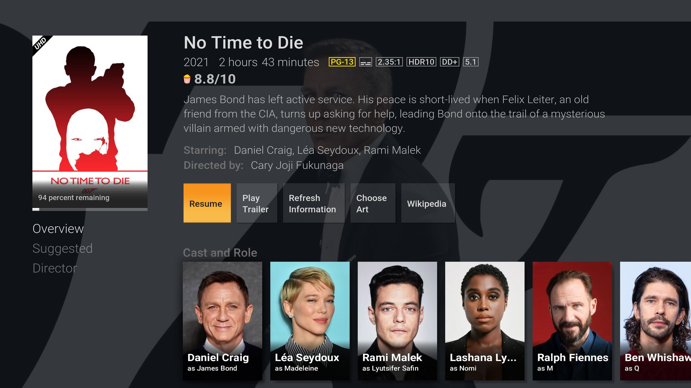
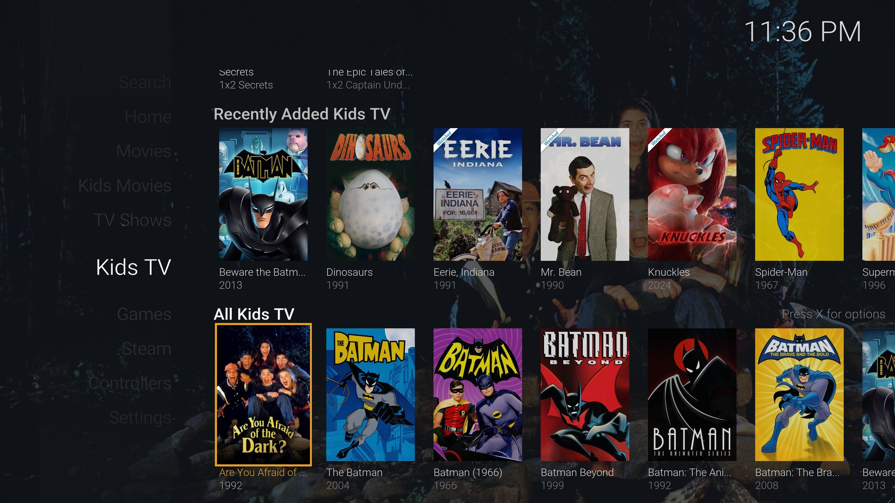

# xelp — a Kodi skin for the living-room TV

A TV-first skin built for a remote or game controller:

- **Poster grid** for your library pages: title and year under every poster, move in any direction.
- **Home pages that scroll** the way you'd expect: stacks of rows (Continue Watching, Recently Added,
  Recommended…), a heading above each, up/down between rows, sideways inside a row.
- **Dimmed backdrop** of the selected title behind the rows, a clock and a greeting.
- **Continue Watching opens the next episode.** Press the context-menu button (X on an Xbox pad) on any item
  for options such as *Reset resume position* to remove it from Continue Watching.
- Film pages open on the **play button**; Rotten Tomatoes audience score is shown when your library has it.
- Titles with no artwork show their name on the card instead of a blank tile.

## Install

1. Download `skin.xelp-1.0.0.zip` from the [latest release](https://github.com/sweatshopking/skin.xelp/releases/latest).
2. In Kodi: **Settings → Add-ons → Install from zip file**, choose the zip (allow unknown sources if asked).
3. **Settings → Interface → Skin → xelp.** Kodi installs the add-ons it depends on from its official repository.
4. First start builds the default menu; set up home rows under the skin's "customise home" settings.

Needs **Kodi 21 (Omega)**. Built for a **3840×2160** layout (it scales to 1080p).

## Tested on

Kodi 21.3 on Linux (CachyOS), a 4K OLED TV, an Xbox-layout controller, with a PlexKodiConnect-managed library.
Other setups are untested; please open an issue with what you find.

## Optional: a wallpaper screensaver

Kodi's own *Picture Slideshow Screensaver* add-on can show a folder of wallpapers at random (set it under
**Settings → Interface → Screensaver**). It is not part of this skin.

## Licence and credit

xelp is a modified version of **fTV by Hitcher** and is released under the same licence,
**CC BY-NC-SA 3.0** — non-commercial, attribution, share-alike. See [NOTICE.md](NOTICE.md) for credit and
the list of changes. Film posters in the screenshots belong to their owners.

## Building the zip

`tools/build-zip.sh` makes `dist/skin.xelp-<version>.zip` (the zip must contain a top-level `skin.xelp/` folder).
`tools/genhub.py` regenerates the home-row template in `xml/Includes_Parameters.xml` (development use only).
